

  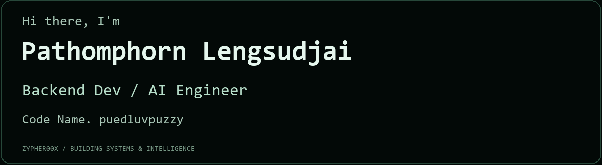

<a href="https://github.com/Zypher00X">GitHub · Zypher00X</a> · <a href="#tech-stack">Tech Stack</a> · <a href="#selected-work">Selected Work</a> · <a href="assets-intro-static.png">Static introduction</a>

พัฒนา Backend, เว็บแอปพลิเคชัน และงาน AI / Computer Vision ตั้งแต่การจัดการข้อมูลและ API ไปจนถึงการนำโมเดลมาสร้างเครื่องมือที่ใช้งานได้จริง

---

## Tech Stack

### Front-end

  &nbsp;
  &nbsp;
  &nbsp;
  &nbsp;
  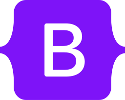&nbsp;
  &nbsp;
  &nbsp;

### Backend

  &nbsp;
  &nbsp;
  &nbsp;
  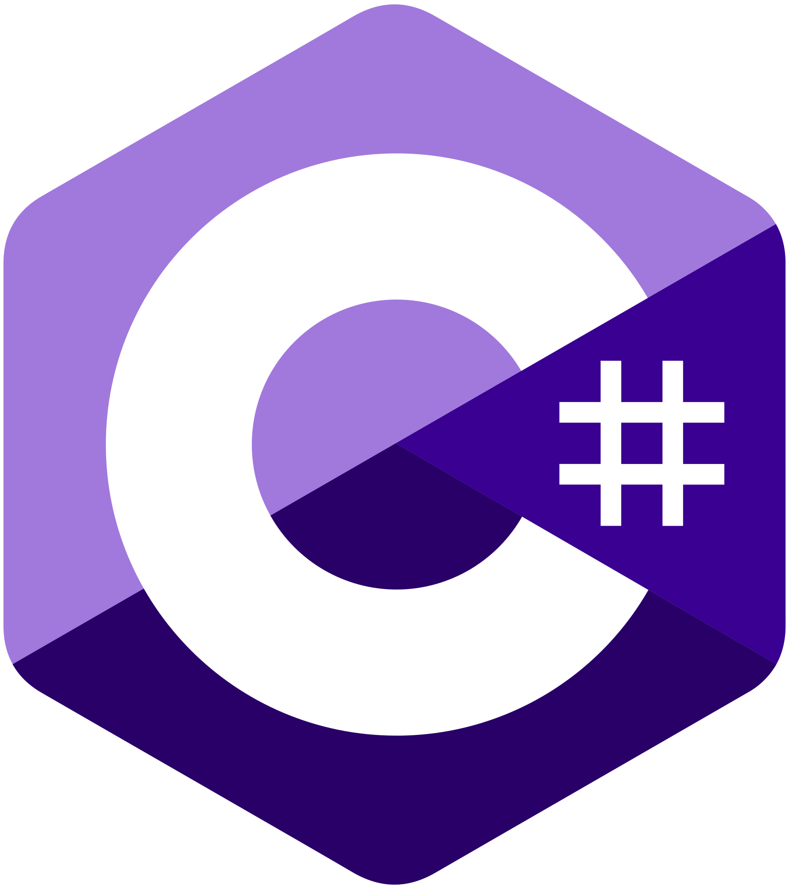&nbsp;
  &nbsp;
  &nbsp;
  &nbsp;
  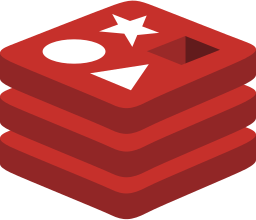&nbsp;

### Database

  &nbsp;
  &nbsp;
  &nbsp;
  &nbsp;
  &nbsp;

### DevSecOps & QA

  &nbsp;
  &nbsp;
  &nbsp;
  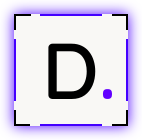&nbsp;
  &nbsp;
  &nbsp;
  &nbsp;
  &nbsp;
  &nbsp;
  &nbsp;
  &nbsp;
  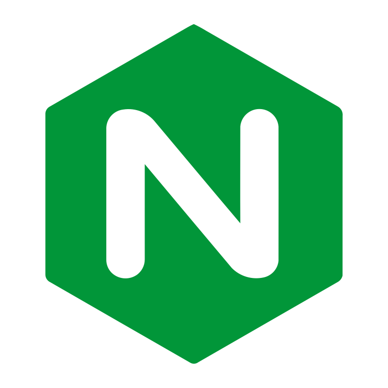&nbsp;

### Linux

  &nbsp;
  &nbsp;
  &nbsp;

### Git

  &nbsp;
  &nbsp;

### Cloud & Deploy

  &nbsp;
  &nbsp;

### Machine Learning & Computer Vision

  &nbsp;
  &nbsp;
  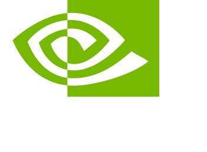&nbsp;
  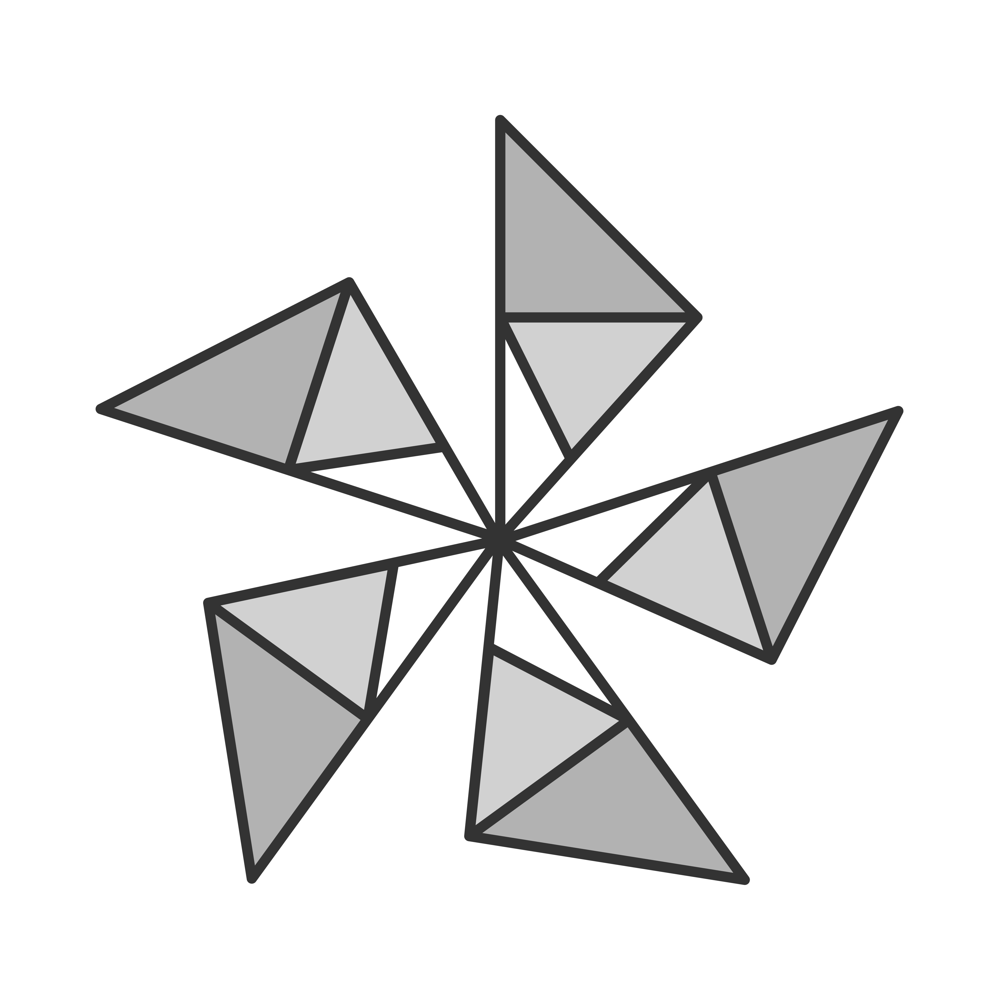&nbsp;
  &nbsp;
  &nbsp;
  &nbsp;
  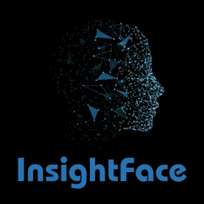&nbsp;
  &nbsp;
  &nbsp;
  &nbsp;

### Code Editor

  &nbsp;
  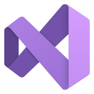&nbsp;
  &nbsp;

### AI Coding Agent

  &nbsp;
  &nbsp;

เกี่ยวกับโลโก้

โลโก้มาจากไฟล์ใน Portfolio: SVGL, Simple Icons และโครงการต้นทาง โดย SQL ใช้ตรา SQL Server, Vector Database ใช้ Qdrant, Torchvision ใช้ PyTorch, Copilot Workspace ใช้ GitHub Copilot และ Codespaces ใช้ GitHub Primer ส่วน pip-audit, Gitleaks และ Batch ใช้ตัวย่อ ชื่อเทคโนโลยีแต่ละรายการระบุใน alt และ title ของภาพ

---

## Selected Work

<table>
<tr><td>
<a href="https://github.com/Zypher00X/ml-engineer-face-swap">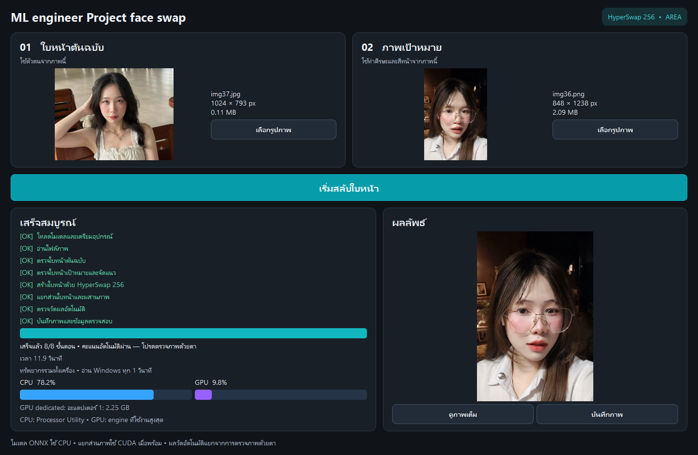</a>
<h3>01 / ML Engineer — Face Swap</h3>

<strong>Computer Vision · Windows GUI</strong>

โปรแกรมสลับใบหน้าผ่าน GUI ภาษาไทยบน Windows ด้วย HyperSwap 256 เลือกภาพต้นฉบับและเป้าหมาย ดูผลลัพธ์ และบันทึก PNG ได้ในหน้าจอเดียว

<ul><li>แยก GUI และ worker ด้วย QProcess + JSON Lines เพื่อให้หน้าจอยังตอบสนองระหว่างประมวลผล</li><li>ตรวจใบหน้าและจัดแนวด้วย InsightFace พร้อมใช้ ONNX Runtime ใน pipeline</li><li>เพิ่ม anti-aliasing, glasses-aware mask, skin-only LAB color matching และ smoothstep feathering</li><li>บันทึก diagnostics และข้อมูลตรวจสอบผลระหว่างขั้นตอน</li></ul>

<strong>Stack:</strong> Python · PySide6 · ONNX Runtime · PyTorch · InsightFace · OpenCV · NumPy

พัฒนาต่อยอดจาก <a href="https://github.com/KwaiVGI/LivePortrait">LivePortrait ของ Kuaishou / KwaiVGI</a> โดยเพิ่ม GUI และ HyperSwap backend รวมถึงเทคนิคประมวลผลภาพข้างต้น โค้ดส่วนต่อยอดดูแลโดย Zypher00X ส่วนโมเดล pretrained เป็นผลงานของเจ้าของโมเดล

<a href="https://github.com/Zypher00X/ml-engineer-face-swap"><strong>ดูโค้ด ภาพตัวอย่าง และรายละเอียดบน GitHub →</strong></a>

</td></tr>
</table>

<table>
<tr><td>
<a href="https://github.com/Zypher00X/rmuti-dorm-finder-python2">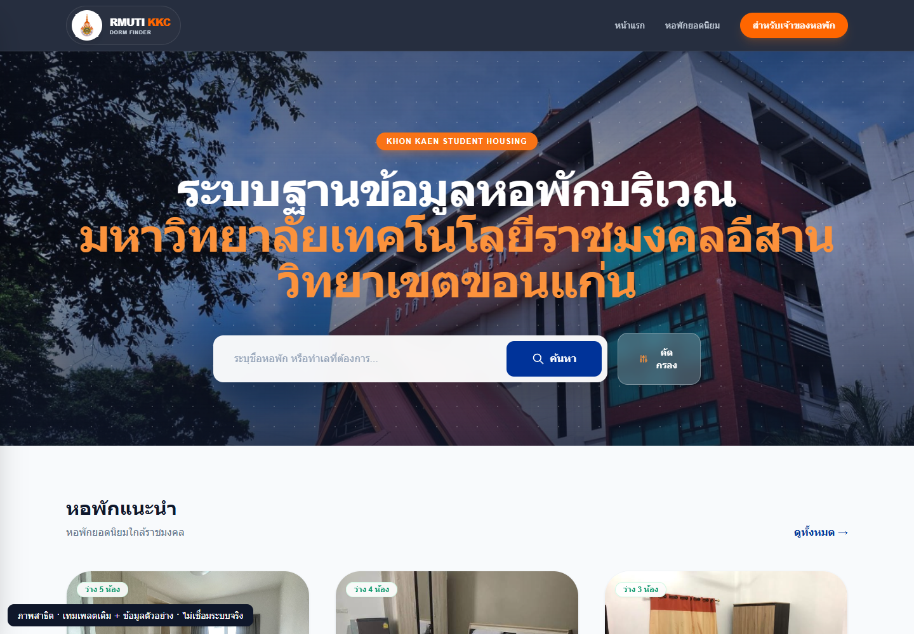</a>
<h3>02 / RMUTI Dorm Finder</h3>

<strong>Full-stack · AI-assisted Search</strong>

เว็บแอปค้นหาหอพักใกล้ มทร.อีสาน วิทยาเขตขอนแก่น เปรียบเทียบราคา ห้องว่าง และสิ่งอำนวยความสะดวก พร้อมระบบเจ้าของหอ ผู้ดูแล และแชท AI

<ul><li>ค้นหา กรอง และเปรียบเทียบหอพัก พร้อมส่งคำขอจอง</li><li>เจ้าของหอจัดการประกาศ รูปภาพ ราคา ห้องว่าง และสถานะการจอง</li><li>ผู้ดูแลตรวจบัญชีและประกาศก่อนเผยแพร่</li><li>ใช้ Gemini ช่วยแปลงคำค้นไทยและตอบคำถามจากข้อมูลหอพัก ร่วมกับ PostgreSQL / pgvector</li><li>ใช้ Redis สำหรับแคช session, rate limiting และ Pub/Sub</li></ul>

<strong>Stack:</strong> Python · FastAPI · Jinja2 · Tailwind CSS · JavaScript · PostgreSQL · pgvector · Redis · Gemini · Docker

<strong>บริบทของงาน:</strong> งานรับจ้างพัฒนาโปรเจกต์จบให้เพื่อน ซึ่งปัจจุบันเรียนจบแล้ว และยินยอมให้นำผลงานมาแสดงใน Portfolio

<a href="https://github.com/Zypher00X/rmuti-dorm-finder-python2"><strong>ดูโค้ด ภาพตัวอย่าง และรายละเอียดบน GitHub →</strong></a>

</td></tr>
</table>

<table>
<tr><td>
<a href="https://github.com/Zypher00X/electricity-tracker">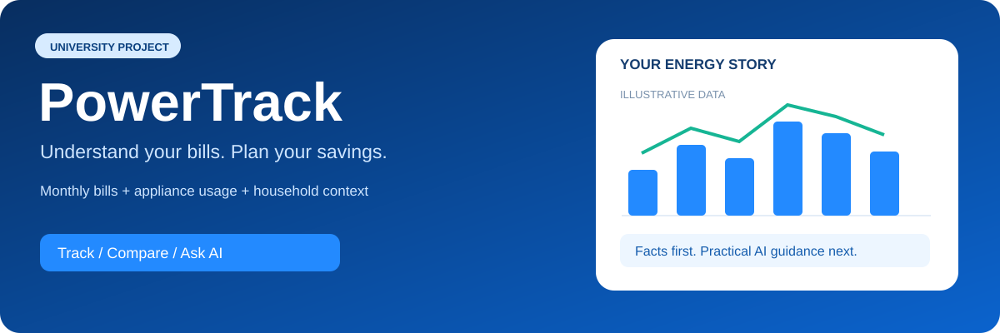</a>
<h3>03 / PowerTrack — Electricity Tracker</h3>

<strong>Full-stack · AI Energy Insights</strong>

ระบบบันทึกค่าไฟ วิเคราะห์เครื่องใช้ไฟฟ้า และวางแผนประหยัดไฟด้วย AI รวมบิลรายเดือน พฤติกรรมการใช้งาน และงบประมาณ เพื่อดูแนวโน้มและขอคำแนะนำจากข้อมูลของตนเอง

<ul><li>สมัครและเข้าสู่ระบบด้วยบัญชีระบบหรือ Google พร้อมแยกข้อมูลแต่ละบัญชี</li><li>บันทึกมิเตอร์ ค่าไฟ และประวัติบิล พร้อมค้นหา กรอง และเปรียบเทียบ</li><li>บันทึกเครื่องใช้ไฟฟ้า กำลังไฟ และเวลาใช้งาน</li><li>ดูกราฟแนวโน้ม ตั้งค่าที่พัก จำนวนผู้อาศัย และงบค่าไฟ</li><li>Backend คำนวณตัวเลขหลัก ก่อนให้ Gemini เรียบเรียงคำแนะนำและรายงาน</li></ul>

<strong>Stack:</strong> FastAPI · Google Sheets · Redis · Gemini · Render

<strong>บริบทของงาน:</strong> มินิโปรเจกต์มหาวิทยาลัยสำหรับบันทึกค่าไฟและวางแผนประหยัดไฟ ตัวเลขประหยัดเป็นค่าประมาณ

<a href="https://github.com/Zypher00X/electricity-tracker"><strong>ดูโค้ด ภาพตัวอย่าง และรายละเอียดบน GitHub →</strong></a>

</td></tr>
</table>

---

[Find me on GitHub · Zypher00X](https://github.com/Zypher00X)
